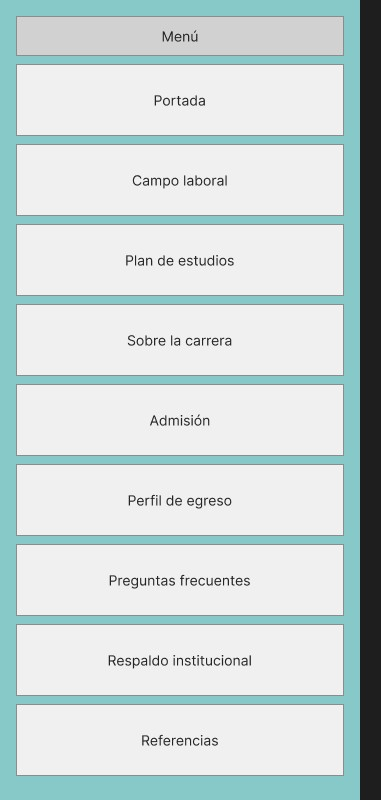
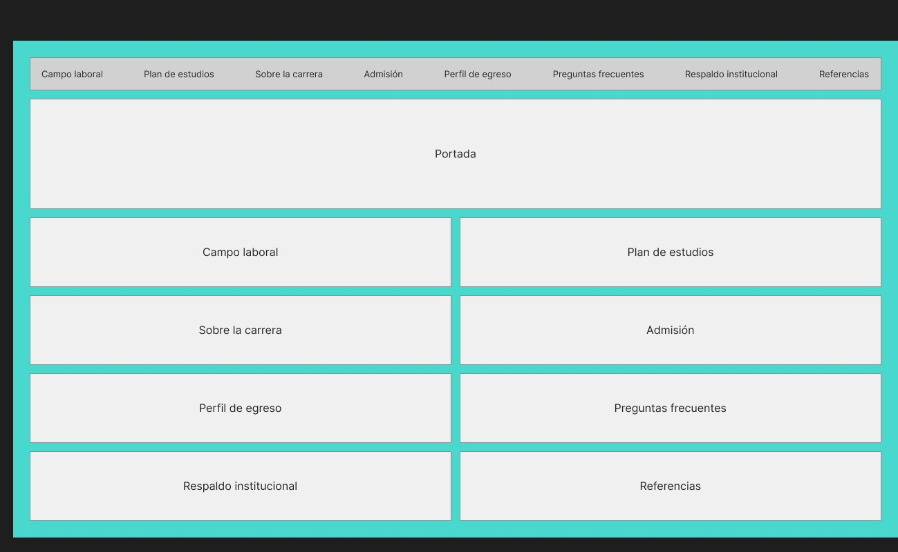

# Informe del proyecto: sitio web de la carrera de Ingeniería en Informática (UTEM)

**Asignatura:** EFE685 – Departamento de Informática y Computación, Universidad Tecnológica Metropolitana (UTEM)
**Docente:** Sebastián Salazar Molina
**Fecha de entrega:** 13 de noviembre de 2026
**Sitio publicado:** [https://bortizp.github.io/proyecto-web-astro/](https://bortizp.github.io/proyecto-web-astro/)
**Repositorio:** [Repositorio](https://github.com/bortizp/proyecto-web-astro.git)

## Integrantes

| Integrante         | Rol en el proyecto                                                                                                                       |
| ------------------ | ---------------------------------------------------------------------------------------------------------------------------------------- |
| Bastian Ortiz      | Rol 3, técnico y despliegue: implementación en Astro, calidad y publicación. También armó la matriz de fuentes y el análisis de audiencia (Productos A y B). |
| Carolaine Palacios | Rol 2, audiencia, redacción y validación: mapa de contenidos, wireframes, textos por sección y prueba con usuarios.                      |
| Marcos Fuentes     | Rol 1, fuentes e investigación institucional: fuentes por sección (`docs/fuentes_por_seccion.md`).                                       |

---

## 1. Resumen

Este proyecto es una página web de una sola vista que presenta la carrera de Ingeniería en Informática de la UTEM. Está pensada para estudiantes de 3.° y 4.° medio y sus familias. Su público secundario son personas que quieren cambiar de carrera o que terminaron la enseñanza media hace tiempo.

La página responde las preguntas que se hace quien evalúa estudiar la carrera: qué es, qué se aprende, qué se puede hacer al egresar, qué respaldo tiene y cómo se postula.

Dos reglas guiaron todo el trabajo:

- Ninguna cifra ni dato verificable aparece sin su fuente citada.
- No se usan frases publicitarias genéricas, como "la mejor carrera", sin evidencia.

## 2. Cómo se trabajó

El contenido se planificó antes de construir la página, en cinco fases. Se hizo así para que cada afirmación del sitio se pueda rastrear hasta una fuente y responda a una duda real del público, y no a una suposición del equipo.

| Fase | Qué se hizo                        | Producto                                  |
| ---- | ---------------------------------- | ----------------------------------------- |
| A    | Búsqueda y evaluación de fuentes   | Matriz de fuentes                         |
| B    | Encuesta al público objetivo       | Perfil de usuario y preguntas priorizadas |
| C    | Diseño de las secciones y su orden | Mapa de contenidos y wireframes           |
| D    | Redacción de los textos            | Textos finales con cifras citadas         |
| E    | Prueba con personas del público    | Registro de validación                    |

---

## 3. Fase A – Matriz de fuentes (Producto A)

Se evaluaron 19 fuentes (17 primarias y 2 secundarias) con cinco criterios: autoridad, vigencia, trazabilidad, objetividad y pertinencia. En la columna de evaluación, ✔ es "cumple" y ✘ es "no cumple"; la justificación de cada criterio está en el Anexo A1. Fecha de consulta de todas las fuentes: 8 de noviembre de 2026. "s. f." indica que la página no muestra fecha de publicación.

| ID | Referencia (APA 7) | Tipo | Fecha del dato | Fecha de consulta | Evaluación | Sección donde se usa |
| --- | --- | --- | --- | --- | --- | --- |
| F01 | Universidad Tecnológica Metropolitana. (s. f.). *Ingeniería en Informática*. https://www.utem.cl/carreras/ingenieria-en-informatica/ | Primaria | s. f. (sin fecha visible) | 8 nov 2026 | Autoridad ✔; Vigencia ✔; Trazabilidad ✔; Objetividad ✘; Pertinencia ✔ | Portada / Sobre la carrera; Perfil de egreso; Admisión (arancel/vacantes) |
| F02 | Universidad Tecnológica Metropolitana. (2022). *Resolución Exenta N.° 03838: Aprueba plan de estudios de la carrera Ingeniería en Informática (código 21030)* [Resolución]. https://transparencia.utem.cl/lbt5 | Primaria | 4 oct 2022 | 8 nov 2026 | Autoridad ✔; Vigencia ✔; Trazabilidad ✔; Objetividad ✔; Pertinencia ✔ | Plan de estudios |
| F03 | Universidad Tecnológica Metropolitana, Departamento de Informática y Computación. (s. f.). *Información académica*. https://informatica.utem.cl/informacion-academica/ | Primaria | s. f. (sin fecha visible) | 8 nov 2026 | Autoridad ✔; Vigencia ✔; Trazabilidad ✔; Objetividad ✔; Pertinencia ✔ | Plan de estudios (apoyo); Perfil de egreso |
| F04 | Universidad Tecnológica Metropolitana, Dirección de Gestión de Calidad. (s. f.). *Certificación de carreras*. https://calidad.utem.cl/certificacion-de-carreras/ | Primaria | Vigencia declarada: 16 jun 2025 a 16 jun 2030 | 8 nov 2026 | Autoridad ✔; Vigencia ✔; Trazabilidad ✔; Objetividad ✘; Pertinencia ✔ | Respaldo institucional |
| F05 | Comisión Nacional de Acreditación. (s. f.). *Búsqueda avanzada de acreditaciones: pregrado, Universidad Tecnológica Metropolitana* [Base de datos]. Recuperado el 8 de noviembre de 2026, de https://www.cnachile.cl/Paginas/buscador-avanzado.aspx | Primaria | Historial de decisiones de Ing. en Informática: 2007, 2010 y 2014 (no aparece acreditación vigente) | 8 nov 2026 | Autoridad ✔; Vigencia ✔; Trazabilidad ✘; Objetividad ✔; Pertinencia ✔ | Respaldo institucional |
| F06 | Universidad Tecnológica Metropolitana. (s. f.). *Admisión: acceso vía PAES*. https://www.utem.cl/admision/admision-acceso-via-paes/ | Primaria | s. f. (sin fecha visible) | 8 nov 2026 | Autoridad ✔; Vigencia ✔; Trazabilidad ✔; Objetividad ✔; Pertinencia ✔ | Admisión |
| F07 | Departamento de Evaluación, Medición y Registro Educacional. (s. f.). *Calendario proceso de admisión 2027*. https://demre.cl/calendario/calendario-proceso-2027 | Primaria | Proceso de admisión 2027 | 8 nov 2026 | Autoridad ✔; Vigencia ✔; Trazabilidad ✔; Objetividad ✔; Pertinencia ✔ | Admisión |
| F08 | Departamento de Evaluación, Medición y Registro Educacional. (s. f.). *Instrucciones generales de postulación*. https://demre.cl/paes/postulacion/como-postulo-a-una-universidad/instrucciones-generales-postulacion | Primaria | s. f. (sin fecha visible) | 8 nov 2026 | Autoridad ✔; Vigencia ✔; Trazabilidad ✔; Objetividad ✔; Pertinencia ✔ | Admisión; FAQ |
| F09 | Universidad Tecnológica Metropolitana. (s. f.). *Oferta académica de pregrado: carreras*. https://www.utem.cl/oferta-academica/pregrado/carreras/ | Primaria | s. f. (sin fecha visible) | 8 nov 2026 | Autoridad ✔; Vigencia ✔; Trazabilidad ✔; Objetividad ✘; Pertinencia ✔ | Sobre la carrera (comparación) |
| F10 | Universidad de Santiago de Chile. (s. f.). *Ingeniería Civil en Informática*. https://informatica.usach.cl/pregrado/ingenieria-civil-en-informatica/ | Primaria | Página modificada 14 ago 2026 | 8 nov 2026 | Autoridad ✔; Vigencia ✔; Trazabilidad ✔; Objetividad ✘; Pertinencia ✔ | Sobre la carrera (comparación con afín 1) |
| F11 | Universidad Tecnológica Metropolitana. (s. f.). *Ingeniería Civil en Computación, mención Informática (prosecución de estudios)*. https://www.utem.cl/carreras/ingenieria-civil-en-computacion-mencion-informatica-prosecucion-de-estudios/ | Primaria | s. f. (sin fecha visible) | 8 nov 2026 | Autoridad ✔; Vigencia ✔; Trazabilidad ✔; Objetividad ✘; Pertinencia ✔ | Sobre la carrera (comparación con afín 2) |
| F12 | Servicio de Información de Educación Superior. (2026, julio). *Matrícula en educación superior en Chile: Informe 2026*. Subsecretaría de Educación Superior. https://www.mifuturo.cl/wp-content/uploads/2026/07/Informe-de-Matr%C3%ADcula-2026.pdf | Primaria | Julio 2026 (matrícula al 30 abr 2026 en pregrado) | 8 nov 2026 | Autoridad ✔; Vigencia ✔; Trazabilidad ✔; Objetividad ✔; Pertinencia ✔ | Campo laboral / contexto de demanda |
| F13 | Servicio de Información de Educación Superior. (2025-2026). *Buscador de empleabilidad e ingresos: Universidad Tecnológica Metropolitana, Ingeniería en Informática* [Base de datos]. Ministerio de Educación. Recuperado el 8 de noviembre de 2026, de https://www.mifuturo.cl/buscador-de-empleabilidad-e-ingresos/ | Primaria | Edición 2025-2026 (cohortes de titulación 2018 a 2023, según la metodología) | 8 nov 2026 | Autoridad ✔; Vigencia ✔; Trazabilidad ✘; Objetividad ✔; Pertinencia ✔ | Campo laboral |
| F14 | Facultad de Ingeniería, Universidad Tecnológica Metropolitana. (2025, 9 de julio). *Ingeniería en Informática UTEM obtiene certificación nacional e internacional por cinco años*. https://fing.utem.cl/2025/07/09/ingenieria-en-informatica-utem-obtiene-certificacion-nacional-e-internacional-por-cinco-anos/ | Primaria | 9 jul 2025 (periodo 16 jun 2025 - 16 jun 2030) | 8 nov 2026 | Autoridad ✔; Vigencia ✔; Trazabilidad ✔; Objetividad ✘; Pertinencia ✔ | Respaldo institucional |
| F15 | Gálvez, R. (2026, 30 de julio). Matrícula de educación superior sigue creciendo: con 1.497.548 registros, suma 5 años consecutivos de máximo histórico. *La Tercera*. https://www.latercera.com/nacional/noticia/matricula-de-educacion-superior-sigue-creciendo-con-1497548-registros-suma-5-anos-consecutivos-de-maximo-historico/ | Secundaria | 30 jul 2026 (Informe SIES 2026) | 8 nov 2026 | Autoridad ✔; Vigencia ✔; Trazabilidad ✔; Objetividad ✔; Pertinencia ✔ | Campo laboral / contexto de demanda (solo complemento) |
| F16 | Elige Tu Futuro. (s. f.). *Ingeniería en Informática en Macul - Universidad Tecnológica Metropolitana* [Datos SIES/Mineduc]. https://eligetufuturo.cl/carrera/ingenieria-en-informatica-universidad-tecnologica-metropolitana-sede-macul-diurna | Secundaria | Oferta 2026 (SIES); empleabilidad e ingreso: Mi Futuro 2025-2026 según el sitio | 8 nov 2026 | Autoridad ✘; Vigencia ✔; Trazabilidad ✘; Objetividad ✔; Pertinencia ✔ | Campo laboral (provisorio hasta confirmar en F13) |
| F17 | Comisión Nacional de Acreditación. (s. f.). *Búsqueda avanzada de acreditaciones: institucional, Universidad Tecnológica Metropolitana* [Base de datos]. Recuperado el 8 de noviembre de 2026, de https://www.cnachile.cl/Paginas/buscador-avanzado.aspx | Primaria | Decisión vigente: acreditada, nivel avanzado, 5 años, del 26 mar 2026 al 26 mar 2031 | 8 nov 2026 | Autoridad ✔; Vigencia ✔; Trazabilidad ✘; Objetividad ✔; Pertinencia ✔ | Respaldo institucional |
| F18 | Universidad Tecnológica Metropolitana, Departamento de Informática y Computación. (s. f.). *Académicos y académicas de jornada completa*. https://informatica.utem.cl/academicos-y-docentes/ | Primaria | s. f. (sin fecha de actualización visible) | 8 nov 2026 | Autoridad ✔; Vigencia ✘; Trazabilidad ✔; Objetividad ✔; Pertinencia ✔ | Respaldo institucional (cuerpo académico) |
| F19 | World Economic Forum. (2025, 9 de enero). *Future of Jobs Report 2025: These are the fastest growing and declining jobs*. https://www.weforum.org/stories/2025/01/future-of-jobs-report-2025-the-fastest-growing-and-declining-jobs/ | Primaria | 9 ene 2025 | 11 nov 2026 | Autoridad ✔; Vigencia ✔; Trazabilidad ✔; Objetividad ✔; Pertinencia ✘ | Preguntas frecuentes |

**Observaciones sobre las fuentes**

- La UTEM está acreditada institucionalmente por la CNA, en nivel avanzado, por 5 años (26-mar-2026 a 26-mar-2031) (F17). Mi Futuro muestra 4 años, un dato anterior, y no se usa.
- La carrera aparece en el buscador de la CNA solo con decisiones antiguas (2007, 2010 y 2014) y con acreditación voluntaria. La certificación vigente de la carrera (16-jun-2025 a 16-jun-2030) la otorgaron la Agencia Acreditadora de Chile y CONAIC, según la Facultad de Ingeniería de la UTEM (F14). Por eso el sitio no afirma que la carrera esté acreditada por la CNA.
- Las cifras de empleabilidad e ingreso salen de Mi Futuro (F13): empleabilidad al primer año 87,1%, al segundo año 96,5% e ingreso al cuarto año de $2.200.000 a $2.300.000. La metodología indica que el ingreso viene de autodeclaraciones al SII.
- La pregunta sobre IA se responde con una proyección mundial del Foro Económico Mundial (F19). No es un dato de Chile (Pertinencia ✘), por eso se presenta como proyección y no como garantía. Fecha de consulta: 11 de noviembre de 2026.
- Las cifras de matrícula salen del Informe SIES 2026 (F12), páginas 5 y 7. Las cifras de prensa que no se encontraron en el informe no se usan.
- La página de la UTEM lista ponderaciones que suman 110 y un "$90.000\*" sin nota; el sitio las muestra "según la UTEM" o no las usa.
- Para el cuerpo académico se cita el listado del departamento (F18). La página de laboratorios está vacía, por lo que el sitio no trata ese tema.

---

## 4. Fase B – Análisis de audiencia (Producto B)

### 4.1 Instrumento y muestra

- Se aplicó un cuestionario breve en Google Forms, de 7 preguntas, que toma unos 3 minutos (Anexo B1).
- El formulario informaba que la participación era voluntaria y anónima, que no se pedía nombre, RUT ni correo, que las respuestas se usarían solo en el proyecto y se presentarían agrupadas, y que la persona podía dejar de responder cuando quisiera.
- Se recibieron 6 respuestas el 7 de noviembre de 2026. En este informe se identifican con los códigos E1 a E6.
- El consentimiento informado se dio por escrito al inicio del formulario (texto en el Anexo B1): la participación es voluntaria y anónima, y las respuestas se usan solo en el proyecto. Las respuestas originales quedan en el formulario del equipo, disponibles para que el docente las verifique.
- Perfiles: 2 estudian 4.° medio, 1 es egresado/a de media y 3 marcaron "Otro". Nadie marcó "Soy familiar de un/a estudiante de media" ni "Quiero cambiarme de carrera o estudiar algo nuevo". El formulario no incluía la opción de 3.° medio.

### 4.2 Perfil de usuario (persona tipo)

Es una síntesis de las respuestas, no una persona real. Cada dato indica cuántas de las 6 personas lo mencionaron.

| Elemento                              | Descripción                                                                                                                                                                                                                                                                                                     |
| ------------------------------------- | --------------------------------------------------------------------------------------------------------------------------------------------------------------------------------------------------------------------------------------------------------------------------------------------------------------- |
| **Contexto**                          | Estudia 4.° medio o ya terminó la media y evalúa estudiar Informática. Conoce la carrera "a medias": 3,0 de 5 en promedio (rango de 2 a 5).                                                                                                                                                                     |
| **Preguntas principales**             | ¿Hay trabajo al titularse? (4 de 6). ¿Cuánta matemática hay? (4 de 6). ¿Cuántos años dura, cuánto se gana y qué puntajes piden? (3 de 6 cada una).                                                                                                                                                              |
| **Dudas o creencias a revisar**       | Exigencia de matemática (promedio de acuerdo 3,0 de 5). Que la IA deje sin trabajo a los informáticos (2 de 6 de acuerdo, con 4 o 5). Que sea más para hombres que para mujeres (2 de 6). Que solo se programe (1 de 6). Nadie estuvo de acuerdo (4 o 5) con que se pueda encontrar trabajo antes de titularse. |
| **Barreras (qué le hace desconfiar)** | Información desactualizada, que no hable de las dificultades y que sean solo fotos bonitas con poca información (3 de 6 cada una). Frases como "la mejor carrera" sin respaldo y cifras sin decir de dónde salen (2 de 6 cada una).                                                                             |
| **Canal por el que llega**            | Instagram, TikTok o YouTube (4 de 6), sitio de la universidad (3 de 6) y familia o amistades (2 de 6). Profesores u orientadores y ferias vocacionales, 1 de 6 cada uno. Nadie marcó Mi Futuro.                                                                                                                 |

### 4.3 Preguntas priorizadas por frecuencia

| #   | Pregunta del público              | Personas | Sección del sitio                                                       | Fuente que se usará              |
| --- | --------------------------------- | -------- | ----------------------------------------------------------------------- | -------------------------------- |
| 1   | ¿Hay trabajo al titularse?        | 4 de 6   | Campo laboral                                                           | Mi Futuro u otra fuente primaria |
| 2   | ¿Cuánta matemática hay?           | 4 de 6   | Plan de estudios y preguntas frecuentes                                 | Malla o decreto oficial          |
| 3   | ¿Cuántos años dura?               | 3 de 6   | Sobre la carrera                                                        | Sitio oficial o decreto          |
| 4   | ¿Cuánto se gana?                  | 3 de 6   | Campo laboral                                                           | Mi Futuro                        |
| 5   | ¿Qué puntajes y requisitos piden? | 3 de 6   | Admisión                                                                | DEMRE y admisión de la UTEM      |
| 6   | ¿Qué se estudia?                  | 2 de 6   | Plan de estudios                                                        | Malla o decreto oficial          |
| 7   | ¿Qué se hace en el día a día?     | 2 de 6   | Perfil de egreso                                                        | Perfil de egreso oficial         |
| 8   | ¿Cómo es la vida de estudiante?   | 2 de 6   | Sobre la carrera (sin testimonio: no hay autorización escrita) | Experiencia del equipo           |

Opciones que nadie marcó (0 de 6): "Costo y gratuidad" y "Si la carrera está acreditada". La sección de Respaldo institucional se incluye igual porque es obligatoria.

Pregunta abierta (P7). Se consideran para la sección de preguntas frecuentes: "¿Qué es lo más complicado de la carrera?", "¿Qué tan posible es ser nómada digital?" y "¿Qué es lo que más te apasiona de lo que estudiaste?" (1 persona cada una). Quedaron fuera 1 comentario sobre la propia encuesta y 1 pregunta sobre el estereotipo "¿Eres hacker?", que el equipo decidirá si aborda; 1 persona no respondió esta pregunta.

### 4.4 Cómo orienta el diseño del sitio

- Campo laboral y Plan de estudios deben ser fáciles de encontrar, porque responden las dos preguntas más frecuentes.
- Las preguntas frecuentes incluyen la exigencia de matemática, el efecto de la IA y la participación de mujeres, cada una con su fuente.
- Cada cifra lleva su fuente y año. El sitio muestra la fecha de actualización y habla de las dificultades de la carrera, porque eso genera desconfianza cuando falta.

### 4.5 Limitaciones

Con 6 respuestas, los resultados son tendencias y no porcentajes de la población. No se cubrió el público secundario (familias y personas que quieren cambiar de carrera).

---

## 5. Fase C – Arquitectura de información (Producto C)

Este es el orden de secciones de la página publicada. Sigue la secuencia de preguntas del encargo: qué es la carrera, qué se aprende, qué se puede hacer al egresar, qué respaldo tiene y cómo se postula. Las cifras de "personas" salen de la encuesta de la Fase B (6 respuestas).

| Orden | Sección | Por qué va en este lugar | Fuentes (IDs) |
| ----- | ------- | ------------------------ | ------------- |
| 1 | Portada | Las personas conocen la carrera "a medias" (3,0 de 5 en promedio). La portada la presenta en pocas líneas y lleva a lo más buscado. | F01, F02 |
| 2 | Sobre la carrera | Responde la primera pregunta del encargo: qué es y en qué se diferencia de carreras afines. 3 de 6 personas preguntaron cuántos años dura y 2 de 6, cómo es la vida de estudiante. Esta última duda no se responde con un testimonio, porque el equipo no tiene autorización escrita. | F01, F02, F10, F11 |
| 3 | Perfil de egreso | Explica qué se podrá hacer antes de mostrar los ramos. 2 de 6 preguntaron qué se hace en el día a día. También responde a "solo se programa", con la que solo 1 de 6 estuvo de acuerdo. | F01, F02 |
| 4 | Plan de estudios | 4 de 6 preguntaron cuánta matemática hay y 2 de 6, qué se estudia. Va después del perfil, para que los ramos se lean como una forma de llegar a esas capacidades. | F01, F02 |
| 5 | Campo laboral | 4 de 6 preguntaron si hay trabajo al titularse y 3 de 6, cuánto se gana. Cierra la secuencia "qué aprendo, qué podré hacer". | F01, F02, F12, F13 |
| 6 | Respaldo institucional | Nadie preguntó por acreditación (0 de 6), pero es una sección obligatoria y 2 de 6 desconfían de frases sin respaldo. Va después de lo que la persona quiere saber. | F14, F17, F18 |
| 7 | Admisión | 3 de 6 preguntaron qué puntajes y requisitos piden. Va después de las secciones que ayudan a decidir si postular. | F01, F06, F07, F08 |
| 8 | Preguntas frecuentes | Reúne dudas y creencias: la IA (2 de 6 de acuerdo), "más para hombres" (2 de 6) y la matemática (acuerdo promedio de 3,0 de 5). | F01, F02, F08, F13, F19 |
| 9 | Referencias | 3 de 6 desconfían de información desactualizada y 2 de 6 de cifras sin fuente. Cada cifra enlaza aquí. | F01 a F19 |

**Cómo se atendieron las dudas más frecuentes.** Las dos preguntas con más menciones (empleo y matemática, 4 de 6 cada una) corresponden a Campo laboral y Plan de estudios, que quedan en la mitad de la página. Por eso ambas tienen un enlace directo en el menú superior, que acompaña al visitante mientras baja, y sus cifras principales aparecen en tarjetas destacadas.

**Diferencia con los wireframes.** Los wireframes de baja fidelidad, hechos antes de implementar, ponían Campo laboral y Plan de estudios justo después de la portada. Al implementar, la página siguió la secuencia de preguntas del encargo. El costo de esta decisión es que dos de las dudas más frecuentes quedan más abajo, y se compensa con el acceso directo del menú.

Secciones obligatorias del sitio: Portada, Sobre la carrera, Perfil de egreso, Plan de estudios, Campo laboral, Respaldo institucional, Admisión, Preguntas frecuentes y Referencias.

---

## 6. Fase D – Redacción (Producto D)

 Los textos finales están en `docs/textos_por_seccion.md` y se cargan en `src/content/`, separados por sección. Para escribirlos se aplicaron cuatro criterios: oraciones de menos de 25 palabras, voz activa, siglas explicadas la primera vez y cada cifra con su año y una cita [Fxx] enlazada a Referencias. Además, no se usaron frases publicitarias sin poco originales, como "la mejor carrera". Estos criterios responden a la encuesta: 3 de 6 personas desconfían de la información desactualizada y 2 de 6, de las cifras sin fuente.

Cada afirmación se marcó según su tipo: (dato) para información institucional con fuente, (interpretación del equipo) para lo que el equipo concluye a partir de los datos y (testimonio) para opiniones personales de estudiantes. La versión final no publica testimonios, porque no hay autorización escrita; el componente queda disponible para usarlo si se obtiene. El sitio muestra esa distinción con una etiqueta visual. Antes de redactar, el Rol 1 definió en `docs/fuentes_por_seccion.md` qué se puede afirmar y qué no en cada sección. Cuando no había un dato verificado, el texto lo dice: "No tenemos un dato verificado sobre esto". 

---

## 7. Fase E – Validación con usuarios (Producto E)

| Código | Tarea | Resultado | Hallazgo | Corrección aplicada |
| ------ | ----- | --------- | -------- | ------------------- |
| V1 | Encontrar el plan de estudios | Sí, en unos 20 s | Lo buscó en el menú | Ninguna |
| V1 | Encontrar si la carrera está acreditada | Sí, en unos 20 s |Lo buscó en el menú | Ninguna |
| V1 | Encontrar cómo se postula |Tarda 5m | Lo busque en DEMRE | Agrega |
| V1 | Encontrar cuántos años dura | 20 s |Lo busque en el menú | Ninguna|
(igual para V2 y V3)

3 personas: Estudiante 4to medio, Estudiante 3ro medio, familiar.

---

## 8. Decisiones de implementación

Esta sección explica, con palabras simples, por qué el sitio está construido como está.

**Astro y casi nada de JavaScript.** Se usó Astro porque arma el sitio completo antes de publicarlo y entrega páginas HTML listas. El navegador del visitante no tiene que ejecutar programas para leer el contenido. Por eso el sitio carga rápido y funciona aunque el celular sea antiguo. El sitio no incluye ninguna isla interactiva: todo el contenido es estático, y el menú, las preguntas frecuentes y los enlaces usan solo HTML y CSS.

**Contenido separado del diseño.** Los datos viven en archivos JSON dentro de `src/content/`: referencias, malla curricular, campo laboral y preguntas frecuentes. Los componentes solo los muestran. Así, quien actualice una cifra no necesita tocar el diseño.

**Datos validados.** Cada archivo de datos tiene un esquema en `src/content.config.ts`, escrito en TypeScript en modo estricto. Si un dato no cumple el esquema, el sitio no se construye. Ejemplos de reglas: toda cifra de campo laboral lleva año y un código de fuente con formato `F00`; toda respuesta marcada como "dato" exige al menos una fuente; toda referencia exige una dirección web válida. Así se evita publicar una cifra sin respaldo por descuido.

**Un componente por sección.** Cada una de las nueve secciones obligatorias es un archivo `.astro` en `src/components/`. Un diseño base común (`src/layouts/BaseLayout.astro`) aporta el encabezado, el menú, el pie de página y las etiquetas de buscadores y redes sociales. La página (`src/pages/index.astro`) solo ordena los componentes.

**Dato, interpretación y testimonio se ven distintos.** Los componentes `Etiqueta` y `Cita` marcan cada afirmación. Cada cifra lleva un código `[Fxx]` que enlaza con la lista de Referencias del final.

**Diseño.** La propuesta visual se hizo en Figma Make y se pasó a código en la rama `diseno-figma`. Se corrigieron los contrastes de color para cumplir WCAG 2.2, se agregó un enlace "Saltar al contenido" y el texto alternativo de los elementos decorativos. Se revisó en 360, 768 y 1280 píxeles, sin desbordes horizontales.

**Publicación.** Una acción de GitHub (`.github/workflows`) construye el sitio y lo publica en GitHub Pages cada vez que se integran cambios en la rama `main`. Las ramas de trabajo no se publican.

**Límites conocidos.**

- La página oficial de la carrera muestra una malla distinta a la de la resolución exenta. El sitio usa la resolución y lo avisa en la sección Plan de estudios.
- La UTEM no publica el año de las vacantes ni del arancel. El sitio informa la fecha de consulta (8 de noviembre de 2026).
- El sitio no publica testimonios. Se retiró el único que había, redactado por una integrante del equipo, porque no existe consentimiento escrito. El componente `Etiqueta` conserva el tipo "testimonio" para usarlo cuando haya autorización.

## 9. Resultados de calidad

Todas las mediciones se hicieron sobre el sitio publicado: https://bortizp.github.io/proyecto-web-astro/

| Medición               | Herramienta           | Meta               | Resultado                                                        |
| ---------------------- | --------------------- | ------------------ | ---------------------------------------------------------------- |
| Rendimiento            | pagespeed.web.dev     | 90 o más           | 100 en móvil (12 nov 2026) y 100 en ordenador (14 nov 2026)      |
| Accesibilidad          | pagespeed.web.dev     | 90 o más           | 100 en móvil (12 nov 2026) y 100 en ordenador (14 nov 2026)      |
| Buenas prácticas       | pagespeed.web.dev     | 90 o más           | 100 en móvil (12 nov 2026) y 100 en ordenador (14 nov 2026)      |
| SEO                    | pagespeed.web.dev     | 90 o más           | 100 en móvil (12 nov 2026) y 100 en ordenador (14 nov 2026)      |
| Accesibilidad WCAG 2.2 | compliascan.com       | 90/100 o más       | 100/100, sin avisos (14 nov 2026)                                |
| Diseño responsivo      | Revisión manual y axe | 360, 768 y 1280 px | Sin desborde horizontal y sin errores de axe en los tres anchos  |

**Observaciones.**

- La primera medición de CompliaScan (12 nov 2026) dio 94/100, con 2 avisos moderados: texto de 11 px y objetivos táctiles menores de 24×24 px. Se corrigieron (texto de 12 px o más y objetivos de al menos 24×24 px) y la medición del 14 nov 2026 dio 100/100.
- Las mediciones de PageSpeed en móvil son anteriores a esas correcciones. No se repitieron, pero las correcciones solo afectaron tamaños de texto y de enlaces.

---

## 10. Declaración de uso de inteligencia artificial

Se usó Claude (Anthropic) como apoyo. Ningún dato se tomó de la IA sin verificarlo: las cifras provienen de las respuestas de la encuesta y de las fuentes de la matriz.

| Herramienta | Tarea                                                 | Prompt (resumen)                                                | Qué se modificó del resultado                                                                                                                                                      |
| ----------- | ----------------------------------------------------- | --------------------------------------------------------------- | ---------------------------------------------------------------------------------------------------------------------------------------------------------------------------------- |
| Claude      | Resumir el documento del profe y organizar el trabajo | Resumen del documento y tareas por rol y por día                | Se usó como guía de organización; los requisitos se verificaron contra el documento original del profe.                                                                            |
| Claude      | Instalación y configuración inicial de Astro          | Qué instalar y cómo instalar TypeScript                         | Los comandos se ejecutaron en el equipo del autor. El comando para instalar astro check falló y se reemplazó por `npm install --save-dev @astrojs/check typescript`.               |
| Claude      | Borrador del cuestionario                             | Cuestionario breve para conocer las dudas del público           | El equipo rehízo gran parte: agregó la escala de acuerdo con 5 frases (P4), la pregunta sobre qué genera desconfianza (P6), la opción Mi Futuro y un texto de introducción propio. |
| Claude      | Ordenar las respuestas en una planilla                | Ordenar el Excel para que sea fácil de leer                     | Se completó con las opciones del formulario que nadie marcó y se corrigió la muestra (no había opción de 3.° medio) al compararlo con el formulario real.                          |
| Claude      | Redactar el Producto B y el Anexo B1                  | Perfil de usuario, tabla de preguntas y cuestionario como anexo | Se ajustó la descripción de la muestra y del instrumento al formulario real y se revisaron las cifras contra las respuestas.                                                       |
| Claude | Buscar y evaluar fuentes y armar la matriz (Producto A) | Completar la matriz según lo que pide el profe y verificar los datos en la CNA, Mi Futuro y el SIES | La lista de fuentes inicial se corrigió (enlaces genéricos reemplazados por páginas específicas y una noticia reemplazada por el informe SIES). Cada dato se verificó abriendo la fuente. Una cifra de prensa que no estaba en el informe del SIES se descartó, y el "4 años" de acreditación de Mi Futuro se reemplazó por el dato vigente de la CNA. |
| Claude | Pasar el diseño de Figma Make a código Astro y revisar calidad | Implementar el diseño elegido con los datos reales del sitio; revisar accesibilidad, desbordes y requisitos del profe | El equipo eligió el diseño en Figma Make. Se corrigieron contrastes, nombres accesibles y el solape del dibujo en 768 px. Los datos no vinieron de la IA: salen de `src/content/` y de las fuentes verificadas. |
| Claude | Atajos técnicos: etiquetas Open Graph, favicon, imagen para redes y README | Completar los requisitos de SEO y documentación | La imagen para redes y el favicon se hicieron con texto propio del sitio, sin imágenes de terceros. |
| Claude | Completar contenido faltante y ordenar la página | Agregar propósito formativo y nota de laboratorios; acortar oraciones; alinear el orden de la Fase C | Cada dato se verificó en su fuente (página de la carrera, F01) antes de incluirse. Lo que no aparece en la fuente se declara como "no tenemos un dato verificado". |
| Claude | Comentarios del código | Documentar línea a línea los componentes, el layout y el esquema de las colecciones | El equipo revisó que cada comentario describa lo que hace el código. |

El código generado con ayuda de IA está comentado línea a línea en los propios archivos (componentes, layout y esquema de las colecciones).

---

## Anexos

### Anexo A1 – Matriz de fuentes completa

Matriz con la justificación de cada criterio por fuente, estados de verificación y notas: `docs/Anexo_A1_Matriz_de_Fuentes.xlsx`.

### Anexo B1 – Cuestionario aplicado

Formulario de Google Forms, 7 preguntas, unos 3 minutos. Texto de introducción: la encuesta es voluntaria y anónima, no pide nombre, RUT ni correo, las respuestas se usan solo en el proyecto y se presentan agrupadas, y se puede dejar de responder cuando se quiera. Copia del formulario: `docs/Anexo_B1_Instrumento.pdf`.

1. **¿Cuál es tu situación?** (una opción)
   - Estudio 4° medio
   - Soy egresado/a de media
   - Soy familiar de un/a estudiante de media
   - Quiero cambiarme de carrera o estudiar algo nuevo
   - Otro

2. **¿Qué tanto sabes de lo que hace un/a ingeniero/a en informática?** Escala de 1 ("nada") a 5 ("mucho").

3. **¿Qué información necesitarías para decidir si estudiar esta carrera?** (máximo 3)
   - Qué se estudia (malla)
   - Cuántos años dura
   - Costo y gratuidad
   - Si hay trabajo al titularse
   - Cuánto se gana
   - Puntajes y requisitos de ingreso
   - Cuánta matemática hay
   - Qué se hace en el día a día de la profesión
   - Si la carrera está acreditada
   - Cómo es la vida de estudiante
   - Otra

4. **¿Qué tan de acuerdo estás con estas frases?** Escala de 1 ("nada de acuerdo") a 5 ("muy de acuerdo").
   - Hay que ser muy bueno/a en matemáticas para estudiarla.
   - La inteligencia artificial va a dejar sin trabajo a los informáticos.
   - Es una carrera donde solo se programa.
   - Es una carrera más para hombres que para mujeres.
   - Se puede encontrar trabajo antes de titularse.

5. **¿Dónde buscas información cuando eliges una carrera?**
   - Sitio de la universidad
   - Mi Futuro
   - Instagram, TikTok o YouTube
   - Profesores u orientadores
   - Familia o amistades
   - Ferias vocacionales
   - Otras

6. **¿Qué te haría desconfiar de una página que promociona una carrera?**
   - Frases como "la mejor carrera" sin respaldo
   - Cifras sin decir de dónde salen
   - Solo fotos bonitas y poca información
   - Información desactualizada
   - Que no hable de las dificultades
   - Otra

7. **Si pudieras hacerle una sola pregunta a un/a estudiante o titulado/a de Informática, ¿qué le preguntarías?** (respuesta abierta)
